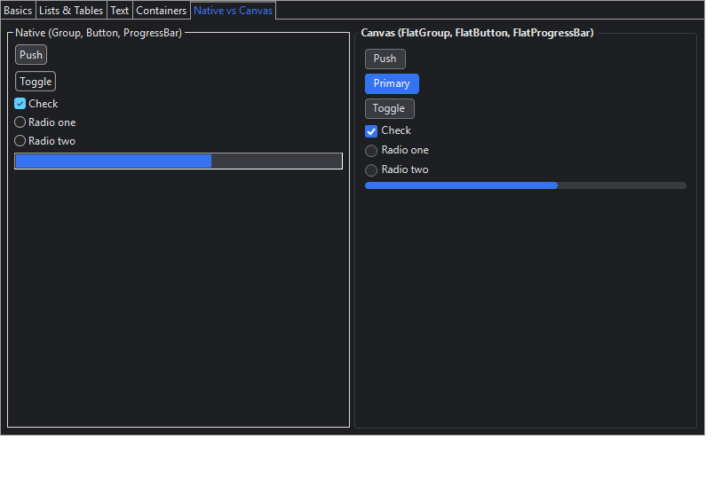

# ZapThemes

A JSON-themed SWT/JFace library: theme-aware proxy subclasses of every SWT and Nebula control, a
`ThemeManager` that re-themes live UIs, and forks of JFace and Nebula that create their widgets
through the proxies. See [docs/PLAN.md](docs/PLAN.md), [docs/phase0-findings.md](docs/phase0-findings.md) and
[docs/phase1-notes.md](docs/phase1-notes.md), [docs/phase2-notes.md](docs/phase2-notes.md),
[docs/phase3-notes.md](docs/phase3-notes.md) and [docs/phase4-notes.md](docs/phase4-notes.md).



## Build

Requires JDK 25 (the Gradle 9.1.0 wrapper is included).

```bash
scripts/fetch-upstream.sh       # pristine JFace/Nebula sources into third_party/
./gradlew build                 # compile, generate proxies, run tests
./gradlew :zapthemes-demo:run             # JFace ApplicationWindow demo (forked JFace)
./gradlew :zapthemes-demo:runStandalone   # plain Display/Shell SWT demo
./gradlew :zapthemes-demo:runNebula       # Nebula widgets demo
```

Other platforms: `-Pswt.platform=gtk.linux.aarch64` etc. FreeBSD needs `-Pswt.localJar=<swt.jar>`.
