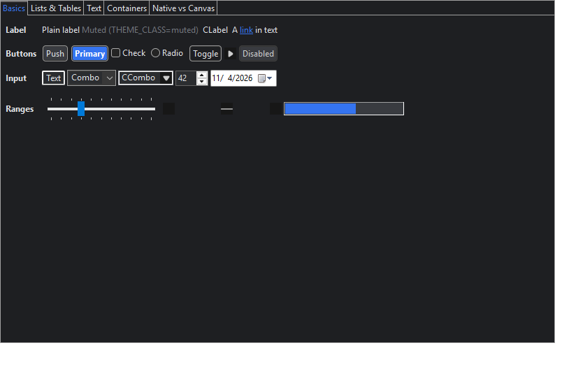

# Phase 1 — Core and SWT proxies

Status (2026-11-04): done on Windows x86_64. Linux and macOS run in CI and have not been checked
yet.

## What exists

- **47 SWT proxies**, generated from `zapthemes-swt/src/proxies/proxies.txt`. They cover every
  themeable, concrete, non-deprecated widget in `widgets`, `custom`, `browser` and `opengl`.
  `com.zapthemes.swt.SwtProxies.ALL` lists them.
- **Not proxied:**
  - Widgets with nothing to theme (`WidgetCatalog.NOT_THEMEABLE`): DnD, Caret, IME, Tracker,
    Tray/TrayItem, TaskBar/TaskItem and ScrollBar. The audit ignores them.
  - Deprecated `AnimatedProgress`.
  - Windows-only OLE widgets, which come with the platform source sets in Phase 3.
- **Theme model:**
  - palette references (`$name`) and `extends`;
  - `inherit` between control rules;
  - style-bit rules (`Button[CHECK|FLAT]`);
  - style classes (`classes`: `Button.primary`, `*.strong`), selected by
    `THEME_CLASS` or `ThemeManager.setThemeClass(widget, "primary strong")`;
  - `states` overrides (read with `ResolvedStyle.state("hover")`; owner-draw renderers in Phase 3
    use them);
  - a `platform` block per windowing system (Phase 3 uses it).
- **`ThemeValidator`** reports every bad color, font, palette reference, style bit, `inherit` target
  and class key, with its JSON path. `zapthemes/theme.schema.json` documents the format for
  editors.
- **Stylers:**
  - every control and item gets background, foreground and font, and composites get an optional
    `backgroundMode`;
  - Table/Tree header colors;
  - CTabFolder selection colors;
  - StyledText selection and margin colors;
  - Link `linkForeground`.
- **`ThemeManager.styleOf(widget)`** returns a widget's resolved style, for custom painting.
- **`auditRawWidgets`** is part of `check` in `zapthemes-swt` and `zapthemes-demo`
  (plugin `zapthemes.raw-widget-audit`).
- **`StandaloneDemo`** is a plain `Display`/`Shell` app built only from proxies. `--smoke` checks
  56 widgets after a theme switch, and `--screenshots <dir>` saves every theme as PNG.

## Tests

| Suite | Tests |
|---|---|
| `ProxyContractTest` | 94 (2 per proxy: mirrors the original's constructors; tagged, themed on creation and re-themed) |
| `ThemeManagerTest` | 6 |
| `ThemeModelTest`, `ThemeValidatorTest` | 12 |
| `CodemodTest`, `ProxyGeneratorTest` | 10 |

## What Windows showed at the end of Phase 1

The screenshot is regenerated on every run, so it shows the current state: Phase 3 has since
closed several of the gaps listed below (see [phase3-notes.md](phase3-notes.md)).

Themed correctly: shell, composites, labels, links, push/toggle buttons (including the `primary`
class), Text, Spinner, Combo text, tabs and the tab selection color.

Native parts that **ignore** the theme and are left for Phase 3 (owner-draw or `Display.setData`
hooks):
- check and radio boxes;
- Combo and CCombo drop-down arrows;
- the DateTime field background;
- the Slider and Scale tracks;
- the ProgressBar bar (native green);
- Group titles;
- the menu bar and window title bar (not visible in `Control.print` screenshots).

## API rule learned from the demo

A proxy `Shell` is an SWT `Composite`, but not a *proxy* `Composite`. Import proxies for `new`,
and use the original SWT types for parameters and fields that accept any widget.
`StandaloneDemo` shows the pattern. The JFace codemod already follows it, because it rewrites
only `new` expressions.
