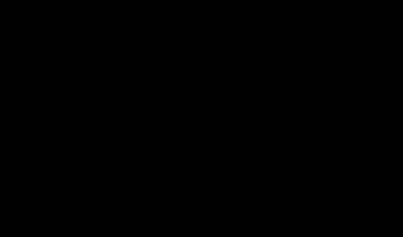

# Phase 2 — JFace fork

Status (2026-11-04): done on Windows x86_64. Linux and macOS have not been run yet; they run in
CI.

## How the fork is built

`zapthemes-jface` contains no copied JFace source. The `zapthemes.fork` plugin generates the fork
on every build from the pristine upstream in `third_party/jface-upstream` (JFace 3.40.0, tag
`R4_41`):

1. **Codemod.** All 421 files are copied, and **193 widget creations** are rewritten to their
   `com.zapthemes.swt` proxies. Only `new` expressions change, so JFace's public API keeps the
   original SWT types. That covers `Window.createShell`, the `MenuManager` / `ToolBarManager` /
   `StatusLineManager` widgets, viewer items, cell editors, and the `org.eclipse.jface.widgets.*Factory`
   lambdas that `Dialog.createButton` and many dialogs now go through.
2. **Patches.** `src/fork/jface-patches/*.patch` holds 3 patches with 13 added lines, applied with
   `git apply` (see that folder's README). They replace JFace's hard-coded colors with style classes:

   | Class | Where |
   |---|---|
   | `banner` (+ `title`) | TitleAreaDialog / WizardDialog title area |
   | `info` | TitleAreaDialog's clipped-message tooltip |
   | `plain` | InputDialog's read-only error text |
   | `pane` | PreferenceDialog's page area and sash |

   Without a theme, the patches only tag the controls, so the fork looks exactly like upstream JFace.
3. **Audit.** The build fails if a themeable widget is still created directly. The current result
   is 0. The report is `build/reports/fork/jface.txt`.

Bumping JFace means changing the ref in `scripts/fetch-upstream.sh` and `UPSTREAM.md`. A patch
that no longer applies fails the build.

## Drop-in packaging

- The fork keeps the `org.eclipse.jface.*` packages. It also declares the capability
  `org.eclipse.platform:org.eclipse.jface:3.40.0`, so a build that also pulls in the official
  jar fails with *"Cannot select module with conflict on capability"* instead of mixing classes.
  This was checked by adding the official jar to the demo.
- **Dependencies:**
  - `core.commands` and `equinox.common` (api);
  - `equinox.bidi` and `org.eclipse.osgi`, needed only for `FrameworkUtil.getBundle`, which
    returns null outside OSGi;
  - the PDE annotations, compile-only.
- **New finding:** JFace 3.40 ships its dialog icons as SVG and requires SWT's SVG rasterizer.
  The fork brings in `org.eclipse.swt.svg` 3.133.100 (built against SWT 3.135.0) at runtime.
  Without it, `MessageDialog` throws *"No SVG rasterizer found"*.

## JFace registries

`JFaceThemeSync` is installed automatically through the new core SPI `ThemeExtension`. It writes
the theme's `registries.colors` / `registries.fonts` into `JFaceResources.getColorRegistry()` /
`getFontRegistry()`, keyed by JFace's own names (`HYPERLINK_COLOR`, `ERROR_COLOR`,
`org.eclipse.jface.dialogfont`, ...). Values JFace had before the first theme are restored when a
later theme no longer sets them. The bundled themes set the JFace colors and all the
`org.eclipse.jface.*font` keys.

## Demo and tests

- `JFaceDemo` (now the default `run` target) is an `ApplicationWindow` with a menu bar, tool bar,
  status line, TableViewer and TreeViewer, plus Message, Input, TitleArea, Wizard and Preferences
  dialogs. The app code is plain JFace.
- `smokeTestJFace` opens the window and every dialog in both themes and checks **226 controls**.
  `smokeTest` now runs both demos.
- `JFaceThemingTest` (4 tests) checks:
  - the widget factories, `Window` and viewers create proxies;
  - window and dialog backgrounds match the theme;
  - the registry sync works, and restores the original values.

Screenshots are in `docs/images/jface-*.png`:

## Known gaps and follow-ups

- **Upstream quirk on Windows:** `ApplicationWindow.getInitialSize()` is ignored when the window
  has a menu bar, because `setMenuBar` sends a Resize before the window opens. The official jar
  does the same (136×88 window in the same test). `JFaceDemo` works around it in
  `initializeBounds`.
- **Not yet reviewed:** other places where JFace sets colors explicitly. Most are in viewers and
  label providers, where they are intended (per-element colors), but some may need a style class
  like the dialogs above: `PopupDialog`, `DefaultToolTip`, `ControlDecoration` hovers,
  `StatusLine`, `IconAndMessageDialog` and `FocusCellOwnerDrawHighlighter`.
- **Native gaps that remain (Phase 3):** table/tree grid lines, check/radio boxes, combo arrows,
  and the menu bar and title bar.
- **JFace's own Composite subclasses** (`StatusLine`, `ProgressIndicator`, `ProgressMonitorPart`)
  keep their upstream superclass. They are tagged and themed through the `SWT.Skin` safety net
  before their first paint.
