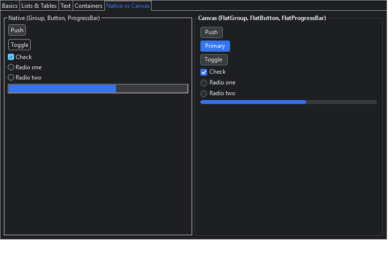

# Phase 3 — Native gaps: platform hooks, owner-draw, canvas replacements

Status (2026-11-04): done and checked on Windows x86_64. On Linux and macOS only
`darkThemePreferred` applies, and those platforms are exercised only by CI.

## 1. Platform settings (`platform` block of a theme)

`PlatformThemeSupport` applies `platform["*"]` overlaid with `platform[<SWT.getPlatform()>]`. It
runs on every widget at creation and on every theme switch.

| Block | Key | Effect |
|---|---|---|
| `*` | `darkThemePreferred` | `Shell.setDarkThemePreferred` (public SWT API since 3.134): dark title bars and native dialogs on Windows (DWM), GTK (prefer-dark) and macOS (`NSAppearance` DarkAqua) |
| `win32` | `darkScrollbars` | `useDarkModeExplorerTheme`: dark scrollbars, check/radio boxes, button frames, Slider, tree arrows |
| `win32` | `darkCombos` | `Combo.useDarkTheme` |
| `win32` | `darkTextIcons` | `Text.useDarkThemeIcons` |
| `win32` | `progressBarColors` | `ProgressBar.useColors`: ProgressBar uses its theme background/foreground |
| `win32` | `menuBarBackground`, `menuBarForeground`, `menuBarBorderColor` | menu bar colors |
| `win32` | `tableHeaderLineColor`, `disabledLabelForeground` | header separator and disabled label color |

SWT reads most of the Windows flags only when a widget is created. For **live** switches,
`Win32ThemeSupport` re-applies the explorer dark mode to existing scrollables, buttons, sliders
and combos, then redraws every shell and its menu bar. It does this through SWT's internal `OS`
class, found by reflection. If that class is missing (a different SWT version), it logs one
warning and only new widgets change.

**Note:** `useDarkModeExplorerTheme` and the menu-bar keys are applied by `Display.setData` but
**not stored**, so `getData` returns null for them.

## 2. Table and Tree owner-draw

These are drawn from the theme on every paint (`ItemPainter`):

| Property | Table | Tree |
|---|---|---|
| `selectionBackground` / `selectionForeground` | ✅ | ✅ |
| `states.hover.background` | ✅ | ✅ |
| `alternateRowBackground` | ✅ as the odd rows' item background, re-checked on every paint, so inserts and sorting keep the pattern. Rows with an application-chosen color are left alone. | — (rows have no stable index) |
| `gridLineColor` | ✅ painted, replacing the native lines | ✅ |

On Windows, native grid lines can't be recolored. `Table` and `Tree` are therefore **hand-written
proxies** (the generator skips any proxy that has a source in `src/main/java`). They implement
`ThemedLines`, so `setLinesVisible` / `getLinesVisible` keep meaning what the application asked
for, while the theme decides between native and painted lines.

## 3. CTabFolder

These are set only when the theme gives them: `selectionBarThickness`, `highlight`, `tabHeight`.
The existing selection and background colors already make tabs flat, so no custom renderer was
needed.

## 4. Canvas replacements: `zapthemes-widgets`

Opt-in classes. A native proxy stays native.

| Class | Replaces | Notes |
|---|---|---|
| `FlatButton` | `Button` push / toggle / check / radio | Hover, pressed, selected (toggle), disabled and focused states from the theme; Space/Enter, mnemonics, Tab traversal; radio groups per parent (`NO_RADIO_GROUP` respected); accessible push/check/radio roles and checked state. `getStyle()` includes the kind, so `FlatButton[CHECK]` rules match. |
| `FlatGroup` | `Group` (title color ignored on Windows) | Client area excludes title and border, so layouts work as with `Group` |
| `FlatProgressBar` | `ProgressBar` | `minimum` / `maximum` / `selection`; `NORMAL` / `ERROR` / `PAUSED` with `barColor` / `errorColor` / `pausedColor` |

Theme types are `FlatButton`, `FlatGroup` and `FlatProgressBar`. Their stylers come from the
module through `StylerProvider`. They set the base colors and font, then repaint; the widgets read
borders, accents and states while painting.

## Before → after on Windows (dark theme)

| Gap after Phase 1 | Now |
|---|---|
| check/radio boxes light | dark (explorer dark mode); fully themed with `FlatButton` |
| Combo/CCombo arrows light | dark (`darkCombos`) |
| Slider/Scale light | Slider dark; Scale track still native |
| ProgressBar native green | theme colors (`progressBarColors`); fully themed with `FlatProgressBar` |
| Group title native | unchanged natively; `FlatGroup` |
| menu bar / title bar | themed (`menuBar*`, `darkThemePreferred`); not visible in `Control.print` screenshots |
| table grid lines white | painted in `gridLineColor`, stripes and selection from the theme |

## Still native, by design or for later

- **`DateTime`** keeps a white field on Windows; the native control ignores colors. Use Nebula
  `CDateTime` (Phase 4).
- **`Scale`** track and ticks.
- **Native dialogs** (`FileDialog`, `MessageBox`, `ColorDialog`) follow only `darkThemePreferred`.
- **Tree alternate rows** are not supported.
- Not part of this phase: a canvas `FlatCombo`. Dark combos cover Windows; revisit if GTK or Cocoa
  need it.

## Tests

| Suite | Tests |
|---|---|
| `PlatformThemeSupportTest` | 2: live switches on existing widgets; the win32 keys SWT stores follow the theme and are reset |
| `TableOwnerDrawTest` | 2: pixel checks of selection, stripe, plain row and grid line; `getLinesVisible` semantics across theme switches |
| `FlatWidgetsTest` | 8: types, click/Space/Enter, check/toggle, radio groups, mnemonics, pixel colors before and after a theme switch, `FlatGroup` client area, progress clamping |

The project total is 138 tests. Both demo smoke tests pass, and `StandaloneDemo --screenshots`
now saves every tab in every theme (`docs/images/zap-<theme>-<tab>.png`).
