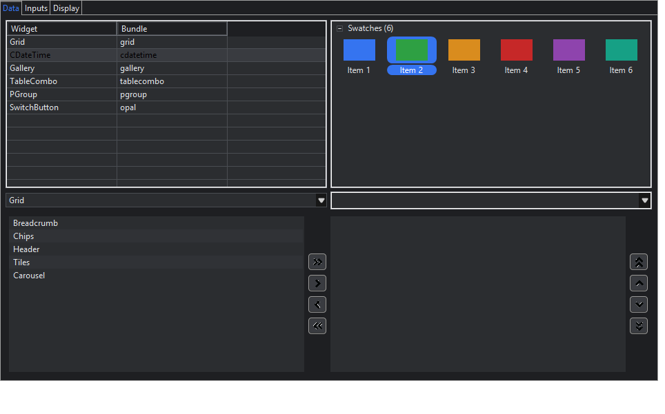

# Phase 4 — Nebula released widgets

Status (2026-11-04): done and checked on Windows x86_64. Linux and macOS run in CI.

## Modules

| Module | What |
|---|---|
| `zapthemes-nebula-fork` | 28 Nebula bundles (298 files, Nebula commit pinned in `UPSTREAM.md`), forked at build time like JFace. It keeps the `org.eclipse.nebula.*` packages. Inside it, 79 SWT widget creations now create proxies, and Nebula's `getSystemColor` calls are themed (below). One patch, for CDateTime. |
| `zapthemes-nebula` | 41 generated proxies (`com.zapthemes.nebula.<widget>.<Class>`, listed in `NebulaProxies.ALL`), plus the stylers |

Covered widgets:
- **Requested:** Grid (+ GridColumn, GridColumnGroup, GridItem; `GridTableViewer` works on the proxy), CDateTime (+ CDatePanel), Gallery (+ GalleryItem), TableCombo (+ CheckTableCombo), PGroup (+ PGroupToolItem), Breadcrumb (+ BreadcrumbItem), CheckBoxGroup, DualList, Header, ProgressCircle, RangeSlider, StarRating, CTreeCombo (+ items, columns), BadgedLabel, Chips, Carousel, SegmentedBar, Tiles.
- **Also:** PShelf (+ PShelfItem), TitledSeparator, RoundedToolbar (+ RoundedToolItem), SwitchButton (+ TriStateSwitchButton), TextAssist, PasswordRevealer, CalendarCombo (+ FlatCalendarCombo, CustomCombo), SplitButton.

Tooling that made this possible:
- `package` directives in proxy lists now work for any library on the classpath, not just SWT.
- The proxy generator copies type parameters (`Tiles<T>`), varargs and `throws` clauses.
- The generator never overrides a `final` `checkSubclass`.

## How Nebula is themed

1. **System colors.** Nebula paints largely with `display.getSystemColor(SWT.COLOR_…)`, in Grid's
   renderers, Gallery, CDateTime, PShelf and Opal. With `themeSystemColors()`, the fork's codemod
   rewrites those calls to `SystemColors.get(display, id)`. That returns the theme's
   `registries.systemColors` entry for the constant (`"COLOR_LIST_SELECTION": "$accent"`), or the
   real system color. The bundled themes map 22 constants.
2. **Setters.** Every Nebula type gets a `PropertyStyler`: theme key `pickerTodayColor` calls
   `setPickerTodayColor(...)`, typed by the setter (color, font, int, boolean, string). Dotted keys
   reach parts: `itemRenderer.selectionBackgroundColor`, `groupRenderer.titleBackground`,
   `strategy.borderColor`, `renderer.shadeColor`. A widget's original values are restored when a
   later theme drops a key. The styler is in core, so it works for any setter-based library.
3. **Special cases.**
   - **PGroup:** its title gradient is a `Color[]`, so it gets `titleBackground` /
     `titleBackgroundGradient`.
   - **CDateTime patch** (`src/fork/cdatetime-patches`): the picker's `updateColorsAndFont()` never
     recolored the weekday labels, and set the day panel three times where it meant the month and
     year panels. Both are fixed.

## Core changes found through Nebula

- **Re-theme walk:** any widget with a public `getItems()` / `getColumns()` returning widgets has
  them walked recursively. Grid, Gallery, CTreeCombo, PShelf and others are reached without
  library-specific code; before this, GridItems kept a previous theme's colors.
- **Color lifetime:** a theme switch used to dispose the old theme's colors and fonts. Widgets
  outside the walk, and colors a library copied into a field, then crashed with *"Argument not
  valid"* on the next paint. Now:
  - `ThemeResources.color` and `SystemColors.get` return a **new `Color` per call**. Colors hold no
    OS resource since SWT 3.115, and some Nebula widgets dispose the colors they were given, which
    must not break other widgets.
  - **Fonts** are cached per display and freed with the display.

## Tests

| Suite | Tests |
|---|---|
| `NebulaProxyContractTest` | 42: each Nebula proxy mirrors its original's constructors, is tagged, and survives live switches (parents made from proxies); GridItems re-themed through `getItems()` |
| `PropertyStylerTest` | 3: setters by name incl. dotted parts, restore on theme change, `SystemColors` mapping and colors staying usable |
| `CodemodTest` | +1: system-color rewrite |

The project total is 184 tests. `smokeTest` now also runs `NebulaDemo`, which checks 87 controls
in both themes. Screenshots are in `docs/images/nebula-<theme>-<tab>.png`.

## Known gaps

- **Breadcrumb** and **RoundedToolbar** paint fixed light gradients from `static` colors, so they
  look the same in every theme. They need a patch.
- **Tiles** colors its tiles through decorator objects (`DecoratorColor<T>`), which a theme value
  cannot express. The default tiles are white; apps set decorators.
- The white single-line borders of `TextAssist` / `PasswordRevealer` are the native Windows `Text`
  border.
- Nebula widgets that Nebula code creates *inside* other Nebula widgets are not proxies, because the
  fork's codemod knows only SWT proxies. They are tagged and themed through the `SWT.Skin` safety
  net.
- Incubation widgets come in Phase 5.
