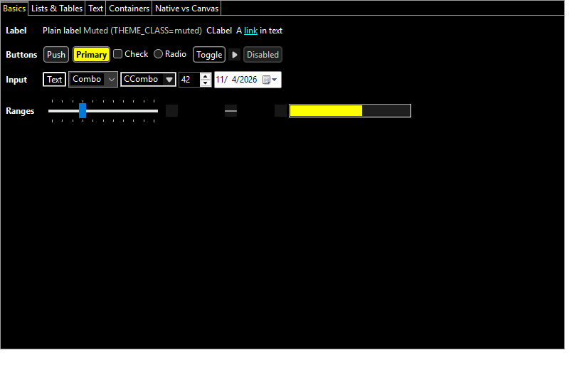
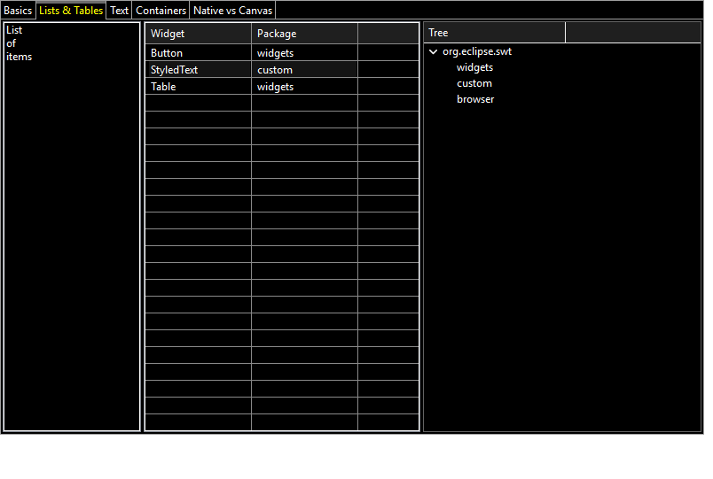
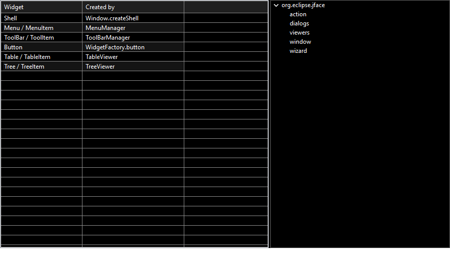
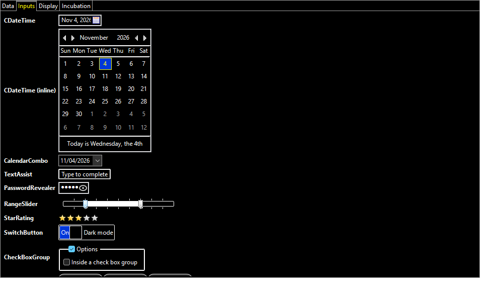
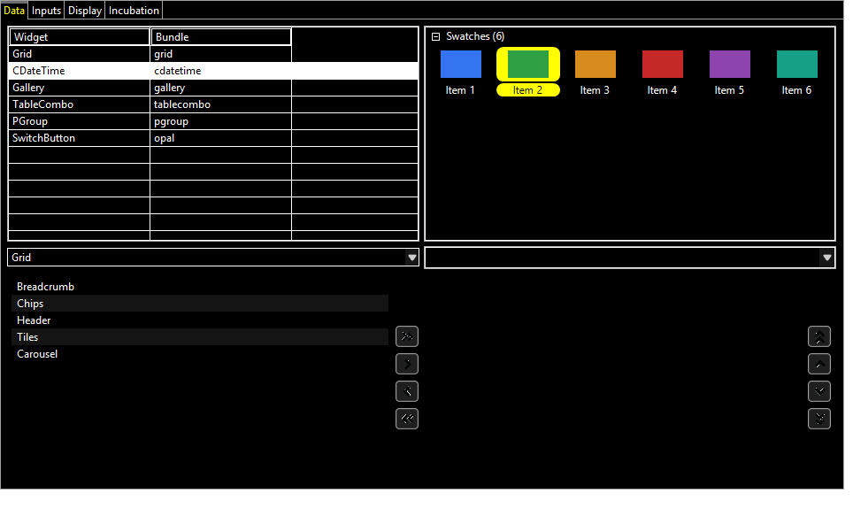

# Phase 6 — Release

Status (2026-11-04): done and checked on Windows x86_64. Linux and macOS run in CI. Nothing has been
published to Maven Central yet: that needs the one-time setup in [releasing.md](releasing.md).

## High-contrast theme

`zap-high-contrast` extends `zap-dark` and changes mainly its palette. Rules written against the
palette follow automatically. It uses black backgrounds, white text and borders, yellow accents,
cyan links, and blue for selection with white text.

- **Explicit overrides:**
  - Grid and header lines are mid-grey (`#8A8A8A`), so empty table rows don't turn into a white grid.
  - The selected tab gets yellow text and a 3 px bar.
  - The CDateTime selected day and the SwitchButton "on" state use the blue selection, since white
    text on yellow is unreadable.
- **Contrast test:** `ThemeValidatorTest.highContrastThemeMeetsWcagAaa` checks that 12 text and
  background pairs reach WCAG AAA (7:1). They cover labels, text fields, buttons, muted labels,
  table headers and selection, tabs, links and the themed system colors.
- **`BundledThemes.IDS`** lists the selectable themes. **`BundledThemes.idFor(highContrast, dark)`**
  picks the one matching the desktop. The demos and their smoke tests now cover all three themes.

| | |
|---|---|
|  |  |
|  |  |

## Documentation

- [theme-authoring.md](theme-authoring.md) covers:
  - adding the library (Gradle and Maven, the SWT fragment recipe, the JFace capability);
  - proxies and imports;
  - choosing and switching themes;
  - every theme block, which rule wins, and the properties per widget;
  - validation;
  - making your own widgets theme-aware.
- [releasing.md](releasing.md) covers the Maven Central setup and release steps.
- **Javadoc:** every published module ships a Javadoc jar. Our own modules are built with doclint
  on (minus missing comments) and produce no warnings. The forks keep upstream's Javadoc, with
  doclint off.

## Samples: `zapthemes-samples`

Four small programs, each with a `run<Name>` task and a `--smoke` mode. CI runs
`:zapthemes-samples:smokeTest`.

| Sample | Shows |
|---|---|
| `HelloZapThemes` | Proxies, bundled themes, `idFor`, live switching |
| `CustomThemeSample` | `acme-dark.json` extends `zap-dark`, adds style-bit and class rules, and is validated on load; accepts a theme file argument |
| `CustomWidgetSample` | `Gauge`, an application canvas widget themed through setters, a `PropertyStyler` and the `StylerProvider` SPI |
| `JFaceSample` | An `ApplicationWindow` on the forked JFace with a Theme menu and a `ThemeChangeListener` |

## Maven publishing

- **`zapthemes.publishing` plugin:**
  - sources and Javadoc jars;
  - POM metadata: name, description, URL, EPL-2.0, developer, SCM;
  - in-memory PGP signing from `signingKey`/`signingPassword`, or a keyring;
  - a `staging` repository in `build/staging-deploy`.
- **`zapthemes.central-bundle` plugin** (root project):
  - `publishToStaging`;
  - `centralBundle`, which refuses snapshots and unsigned artifacts;
  - `uploadToCentral`, which posts to the Portal publisher API as `USER_MANAGED`, so a human still
    presses Publish.
- **[release.yml](../.github/workflows/release.yml):** a tag `v*`, or a manual run, tests
  everything, then builds, signs and uploads the bundle.
- **SWT in published metadata:** the SWT fragment moved from `api` to an unpublished `swt`
  configuration, which every classpath of the module extends. Published metadata depends on the
  platform-neutral `org.eclipse.swt` placeholder instead, as JFace on Maven Central does. Before
  this, a POM built on Windows would have pulled win32 natives into every consumer.
- **draw2d:** it was a `files(...)` dependency, which Gradle silently leaves out of POMs. The new
  `zapthemes-draw2d` module republishes the GEF jar unchanged, minus the Eclipse signature and
  manifest. In the build it is unpacked as a classes directory, so projects compile against it
  like any module.
- **Version:** `1.0.0-SNAPSHOT`. A release passes `-Pversion=1.0.0`.

**Checked on Windows:**

- **Consumer project:** a separate Gradle project using only the staged artifacts and Maven Central,
  with the documented recipe, resolved the dependency graph with no win32 dependency from our POMs
  and draw2d coming from `zapthemes-draw2d`. Its themed forked-JFace `TableViewer` and a Nebula
  `TimelineComposite` ran.
- **Signed bundle:** with a throwaway key, `centralBundle -Pversion=1.0.0` produced a 522-file
  bundle in which every file has an `.asc` signature and md5/sha1/sha256/sha512 checksums;
  `gpg --verify` passed.
- **Guards:** the snapshot and unsigned-artifact checks fail as intended.

The upload itself has not been run: it needs a Portal token and the verified `com.zapthemes` namespace.

## Decisions

- **Namespace:** the group stays `com.zapthemes`. Before the first release, verify it in the Central
  Portal with a DNS TXT record on `zapthemes.com` ([releasing.md](releasing.md)).

## Open

- **FreeBSD:** the CI job is still commented out until the ports SWT matches 3.135.0.
