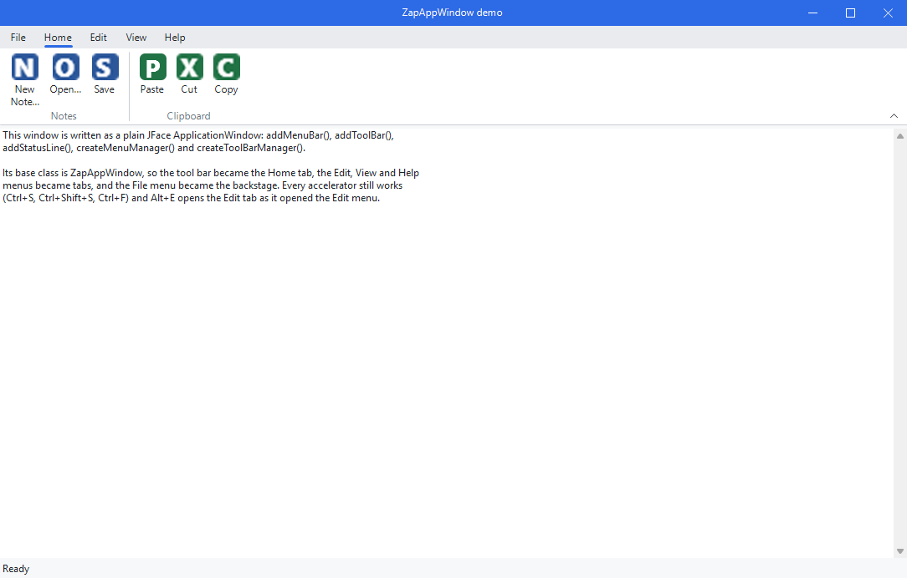

# ZapAppWindow plan

`ZapAppWindow` is JFace's `ApplicationWindow` with the Office look: an Office-style title bar with
the quick access toolbar, a ribbon in place of both the menu bar and the tool bar (or cool bar),
the File menu as the backstage, and JFace's status line at the bottom. An application changes
its base class from `ApplicationWindow` to `ZapAppWindow` and runs. Its `addMenuBar()`,
`addToolBar()` and `createMenuManager()` code keeps working and is turned into ribbon tabs and
groups. Writing `createRibbon()` by hand then makes the ribbon a good one.



Part 2 is a Claude Code skill, shipped as a plugin in this repository, that does that rewrite for
an existing JFace application.

Publishing to Maven Central stays on hold until the user says everything works. Each step below
ends in its own PR against `master`, with tests and docs.

## Decisions

Asked and answered by the user:

| Question | Answer |
|---|---|
| `RibbonApplicationWindow` | **Replaced.** `ZapAppWindow` takes over its code and `RibbonApplicationWindow` is deleted. Only its own test uses it, and it was never published |
| `addMenuBar()` / `addToolBar()` / `addCoolBar()` and the `create*Manager()` overrides | **Converted at runtime**, not deprecated: no native menu bar, tool bar or cool bar is created; the managers become ribbon tabs and groups and the File menu becomes the backstage. `createRibbon()` can adjust or replace the result |
| Title bar | **Always on.** `ZapAppWindow` extends `TitleBarWindow`; the quick access toolbar shares the ribbon's command registry |
| Is the skill still needed? | **Yes, with a smaller scope.** Runtime conversion makes apps *run* after a base-class swap; the skill turns the automatic ribbon into a hand-written `createRibbon()` with stable ids, a curated Home tab, group labels, large icons and backstage pages |
| Where the skill lives | **A plugin in this repository** (`plugins/zapthemes/`, with a marketplace file), so other projects and outside users of the library can install it, versioned with the library |

Decided here (the user can change them):

| Question | Answer |
|---|---|
| Module and package | `zapthemes-jface-ribbon`, `com.zapthemes.jface.ribbon.ZapAppWindow`. That module already depends on `zapthemes-jface` (`TitleBarWindow`, the forked JFace) and `zapthemes-widgets` (`Ribbon`, `TitleBar`). The module description changes to name the window |
| The forked `ApplicationWindow` | Not patched. Every hook needed (`addMenuBar`, `addToolBar`, `addCoolBar`, `createTrimWidgets`, `getMenuBarManager`, `getToolBarControl`, `toolBarChildrenExist`, `showTopSeperator`, `getLayout`) is overridable, so `ZapAppWindow` works the same over upstream JFace |
| Keyboard shortcuts | A new `CommandKeyBindings` in `com.zapthemes.widgets.command` (plain SWT, so non-JFace ribbon apps get it too) runs commands by their `shortcut()`. Today the shortcut is only shown in tooltips; with no menu bar, every accelerator would stop working without it |
| Ids for actions without one | `ActionCommands` gets a fallback id: `menu path` + `label`, lower-cased (`edit.rename`). The action itself is not changed (`setId` is never called on the app's action) |
| Ribbon customization file | `getRibbonPreferences()` returns a `Path`, `null` by default (nothing is kept), like `getTitleBarPreferences()`; the title bar and the ribbon share one `CustomizationStore` when both return the same file |
| Accelerator text in labels | Fixed in `ActionCommands.text`: it strips `\t…` but not JFace's `@Ctrl+N` form (ZapNotes writes `"&Save@Ctrl+S"`), so the ribbon would show `Save@Ctrl+S`. Use `LegacyActionTools.removeAcceleratorText` |

## What exists

- `RibbonApplicationWindow` (`zapthemes-jface-ribbon`): opt-in `addRibbon()`, a
  `createRibbon(Ribbon)` hook, the ribbon returned by `getToolBarControl()` so JFace's layout puts
  it where the tool bar goes, no top separator, and `command(IAction)` through `ActionCommands`.
  It does not stop `addMenuBar()` or `addCoolBar()`, and it cannot read a `MenuManager` or
  `ToolBarManager`.
- `ActionCommands` and `RibbonContributions` (same module): actions as commands, kept in sync both
  ways; contribution items into groups and rows (actions → buttons, `MenuManager` → drop-down,
  `Separator` → a line in rows).
- `TitleBarWindow` (`zapthemes-jface`): the Office title bar and quick access toolbar over an
  `ApplicationWindow`, its own layout (bar, tool bar or cool bar, contents, status line), and a
  menu bar turned into the title's document menu.
- `Ribbon` (`zapthemes-widgets`): tabs, groups, KeyTips (`setKeyTip`), the backstage
  (`setFileTab(label, Consumer<Backstage>)`, with `addPage`, `addCommand`, `addSeparator`),
  collapse, contextual tabs, customization, and a `CommandRegistry` per shell.
- Users of `ApplicationWindow` in the repo: `JFaceDemo` (menu bar, tool bar, status line),
  `JFaceSample` (menu bar, status line) and ZapNotes in `apps/zapnotes` (menu bar, tool bar, status
  line, actions with no ids and `@` accelerators), the test beds for both parts.

## Part 1: ZapAppWindow

### The class

```java
public class ZapAppWindow extends TitleBarWindow {
    public ZapAppWindow(Shell parentShell);

    // the ribbon
    protected void createRibbon(Ribbon ribbon);          // after the automatic contents, if any
    protected void createBackstage(Backstage backstage); // after the File menu's entries, if any
    public Ribbon getRibbon();                           // null until the shell exists
    protected Command command(IAction action);           // register an action (ActionCommands)
    protected Path getRibbonPreferences();               // the customization file, null = none
    protected String getFileTabLabel();                  // "File"

    // what automatic conversion does
    protected boolean convertMenus();                    // true; false ignores the managers' contents
    protected RibbonConversion createRibbonConversion(); // the rules below, replaceable
}
```

The ribbon is always there: no `addRibbon()` call. The `TitleBarWindow` hooks
(`createTitleBar`, `addQuickAccess`, `getTitleBarPreferences`) stay.

```java
class Editor extends ZapAppWindow {
    Editor() { super(null); addStatusLine(); }
    @Override protected void createRibbon(Ribbon ribbon) {
        RibbonTab home = ribbon.addTab("home", "Home");
        RibbonContributions.add(home.addGroup("home.clipboard", "Clipboard"), paste).large();
    }
}
```

### The `ApplicationWindow` calls

| `ApplicationWindow` | In `ZapAppWindow` |
|---|---|
| `addMenuBar()` | Calls `createMenuManager()` and keeps the manager; **no** SWT menu bar is set on the shell and the title bar gets no document menu. The manager's contents become the backstage (File) and tabs (the other menus) |
| `createMenuManager()` | Unchanged for the app: still where the menus are written |
| `getMenuBarManager()` | Returns that manager, so code that finds or adds items in it still compiles and runs. After the shell exists, `refreshRibbon()` rebuilds the automatic part from the managers (the app calls it where it called `menuManager.update(true)` for structural changes). Enabled, checked and label changes need no call: they reach the ribbon through the action |
| `addToolBar(style)` / `createToolBarManager(style)` / `getToolBarManager()` | The manager is created and kept, no `ToolBar` widget is created; its items go to the start of the Home tab (below). `getToolBarControl()` returns the ribbon, which keeps the window's layout |
| `addCoolBar(style)` / `createCoolBarManager(style)` / `getCoolBarManager()` | The same, each `ToolBarContributionItem` becoming one group in Home |
| `createToolBarManager2` / `createCoolBarManager2` / `getToolBarManager2` / `getCoolBarManager2` | The same as the above |
| `addStatusLine()` / `createStatusLineManager()` / `getStatusLineManager()` / `setStatus(…)` | Unchanged. The status line keeps its place at the bottom of `TitleBarWindow`'s layout |
| `run(fork, cancelable, runnable)` | Unchanged: the progress monitor is the status line's. While it runs, the ribbon is disabled like JFace disables the tool bar and menu bar (`ApplicationWindow.run` only knows those; override and disable the ribbon and the quick access toolbar too) |
| `showTopSeperator()` | `false` |
| `getLayout()` | `TitleBarWindow`'s layout: title bar, ribbon, contents, status line. While the backstage is open it covers everything below the title bar |

### Automatic conversion (`RibbonConversion`)

Run once in `createTrimWidgets`, after the ribbon is created and before `createRibbon`, and again
by `refreshRibbon()`. Everything it builds has ids starting with `auto.`, so `createRibbon` can
find and remove what it replaces, and the customization file keeps them apart from hand-made ids.

1. **The File menu → the backstage.** The top-level `MenuManager` whose id is `file`, else whose
   text without `&` is `File`, is the backstage (`setFileTab(getFileTabLabel(), …)`):
   - each action becomes a command entry (`backstage.addCommand`), separators become separators;
   - a submenu (Recent Files, Export As) becomes a page that lists its actions as buttons;
   - `Exit` and `Close` (by id, else by label) are kept last, as in Office;
   - no File menu: an empty backstage with only *Close*, so the File tab is always there. An app can
     turn the File tab off with `getFileTabLabel()` returning `null`.
2. **Every other top-level menu → a tab**, in order, labeled with the menu's text without `&`.
   Its mnemonic letter becomes the tab's KeyTip, so Alt, E still reaches Edit.
3. **Menu sections → groups.** A menu's items are cut into groups at separators. A group's label
   is the separator's group name when it has one (`new Separator("clipboard")` → *Clipboard*),
   else the label of the group's first item. Items are medium buttons (large when the action has a
   large image set through `ActionCommands.setLargeImage`), and their mnemonics become KeyTips.
4. **Submenus → drop-down buttons** whose menu is the submenu (as `RibbonContributions` does), so
   dynamic submenus (`ContributionItem.fill(Menu, int)`, a theme list) keep working.
5. **The tool bar or cool bar → a Home tab first**, unless a menu is already called Home. Its
   items make one group per tool bar section, labeled from the separator's group name, else
   generic labels (*Commands 1*, *Commands 2*). Buttons are large. The same
   action on the tool bar and in a menu is one command, shown in both places.
6. **The Help menu** (id `help`, else its text) becomes a tab like the others; its *About* entry
   is also added to the backstage, after the separator above *Options*, as in Office.
7. **Skipped with a warning:** `ControlContribution`s (the ribbon draws on a canvas and does not
   host native controls), `GroupMarker`s (they mark places, not commands), and items that are not
   visible. The log line names the item and says to write it in `createRibbon`.
8. **Ids:** an action's id, else its definition id, else `auto.` + the menu path + the label
   (`auto.edit.rename`), made unique within the window.

### The backstage

- `createBackstage(Backstage)` runs after the automatic File entries; the app adds pages (Info,
  New, Open with recent files, Options) there. It is also where an app removes the automatic
  entries it replaces by its own pages.
- Esc, the back arrow and running an entry close it, as now. The title bar stays visible above it.

### The status line

Kept as JFace makes it, in its usual place. Two additions, both small:

- hovering a ribbon item writes the command's description to the status line, as JFace's tool bar
  does through the action's tooltip (off with `setRibbonStatusMessages(false)`);
- `run(…)` with a progress monitor disables the ribbon (above).

### Keyboard shortcuts and accelerators

Without a menu bar, SWT stops running accelerators (they belong to menu items), so:

- **`CommandKeyBindings.install(shell, registry)`** (in `zapthemes-widgets`): a `KeyDown` display
  filter, active while the shell is the active shell (and not while a modal dialog of it is open),
  that matches the key against `Command.shortcut()` of every visible command and runs the
  enabled one. It stops the event when it ran a command, so the focus control does not also get
  it, as with menu accelerators on Windows. Two commands on one shortcut: the first registered
  wins and the conflict is logged once.
- **Every action in the menu bar and tool bar is registered**, also those the ribbon does not
  show (left out by `createRibbon` or hidden by the user), so every accelerator from the menus
  still works.
- **Accelerators come from the action:** `IAction.getAccelerator()`, which JFace fills from
  `"Save\tCtrl+S"` or `"Save@Ctrl+S"`; a change to it updates the command (`Command.SHORTCUT`).
  Actions with only an `actionDefinitionId` and a key binding in the Eclipse workbench are
  out of scope: plain JFace apps don't have bindings.
- **Mnemonics:** menu mnemonics become KeyTips (tabs and items). The ribbon's Alt handling
  replaces the menu bar's; F10 still works. Alt with a letter pressed together (Alt+F as one
  chord, how menu-bar users type it) opens the KeyTip for that letter at once: check whether
  `KeyTips` does this today, and add it if not.
- Shortcuts show in super tooltips and the ribbon's menus, as now.
- Context menus (`MenuManager.createContextMenu`) are not affected.

### Tests (`ZapAppWindowTest` in `zapthemes-jface-ribbon`, with a `Display`)

- A window with `addMenuBar()`, `addToolBar()` and `addStatusLine()`: the shell has no menu bar,
  no `ToolBar` or `CoolBar` child, a title bar, a ribbon, and a status line under the contents.
- Conversion: File → backstage entries in order with separators, Exit last; Edit and View →
  tabs with groups cut at separators and labeled; tool bar → Home first, large; a submenu → a
  drop-down whose menu has the submenu's items; generated ids are stable across two windows; a
  `ControlContribution` is skipped and logged.
- `createRibbon` runs after conversion and can remove an `auto.` group; `refreshRibbon()` after
  adding a menu item shows it.
- Shortcuts: an accelerator from `"Save@Ctrl+S"` runs the action through `CommandKeyBindings`
  (the filter's handler is called with a made `Event`; posting real key events is unreliable on
  CI); a disabled command does not run; an action only in a menu the ribbon leaves out still runs
  by its shortcut; a conflict is logged.
- Labels: `"&Save@Ctrl+S"` shows as *Save*.
- `run(…)` disables and re-enables the ribbon; `setStatus` and hover messages reach the status line.
- The existing `JFaceRibbonTest` window moves to `ZapAppWindow`.
- `CommandKeyBindingsTest` in `zapthemes-widgets` for the filter alone.
- Demo: `JFaceDemo` gets a `--ribbon` switch, or a new `runZapAppWindow` task runs it with the
  base class swapped, so the automatic ribbon is seen on a real menu set; screenshots in every theme.

### Docs

- `docs/ribbon-plan.md`: the JFace integration section points to `ZapAppWindow` (and the
  removed `RibbonApplicationWindow`).
- `docs/theme-authoring.md` (using it in an app) and `docs/examples.md`: *From ApplicationWindow to
  ZapAppWindow*: swap the base class, add the dependency, then what conversion does and how to
  replace it by `createRibbon`.
- `README.md`: the run line for the demo.
- Javadoc on `ZapAppWindow` with the table above, and on `CommandKeyBindings`.
- An *As built* section in this file.

### Steps

| # | Step | What |
|---|---|---|
| 1 ✅ | **Shortcuts** | `CommandKeyBindings`, the `@` label fix and the fallback id in `ActionCommands`, with their tests. Every `Ribbon` installs the bindings of its shell, so plain SWT ribbon apps get them too; a shortcut that the shell's own menu bar also has is left to the menu bar |
| 2 ✅ | **ZapAppWindow** | The class over `TitleBarWindow`, the managers intercepted, the ribbon in the layout, the status line and `run(…)`; `RibbonApplicationWindow` removed and its test moved. As built: the ribbon is created in `createToolBarControl`, so JFace's own layout code places it; `Ribbon.setBackstageHeader(Control...)` (new) keeps the title bar above the open backstage; `getRibbonPreferences()` is one `CustomizationStore` for both bars unless `getTitleBarPreferences()` names a different file (the title bar's own file is a Properties file, so the two can't share one path otherwise). `run(…)` turns the shortcuts off; the title bar stays enabled, for its caption buttons. The status line's hover messages move to step 3, which needs a hover listener on the ribbon |
| 3 ✅ | **Conversion** | `RibbonConversion`: backstage, tabs, groups, Home, KeyTips, ids, `refreshRibbon()`; the demo and its screenshots. As built: every action in the menus and tool bar is registered before any tab is made, so accelerators work for actions only the (lazy) backstage shows; group ids are a namespace of their own (a group `auto.edit.find` beside the command `auto.edit.find`); a dynamic `ContributionItem` becomes a drop-down it fills on each open; File submenus are backstage pages of buttons built from the menu as it would show, again on each open; new ribbon API: `addTab(index, …)`, `removeTab`, `RibbonTab.addGroup(index, …)`, `removeGroup`, `addHoverListener`, `Backstage.entryIds()`, Alt+letter chords (`RibbonTest`), and `setFileTab` replaces a backstage already made. Demo: `ZapAppWindowDemo` (`runZapAppWindow`, `smokeTestZapAppWindow`), screenshots composed per child (`DemoSupport.screenshotByChildren`) since printing a title-bar shell offsets its children |
| 4 ✅ | **Docs** | The docs above: the guide is a subsection of [theme-authoring.md §7](theme-authoring.md#a-jface-application-window-with-the-ribbon-zapappwindow), where using the ribbon in an app is described, with a pointer from [examples.md](examples.md) |

Steps 1–3 can be one PR if they turn out small; step 1 is useful on its own to plain SWT ribbon
apps.

### Risks

- **Shortcuts stolen from text fields.** A command on Delete or Ctrl+C runs instead of the text
  field's own key, as a menu accelerator would on Windows (GTK and macOS give the focus control the
  key first). The filter does what Windows' menu bar does on every platform, so behavior is the
  same everywhere; apps that bind plain keys should check. Documented.
- **Title bar on GTK and macOS**: `TitleBarWindow`'s custom frame is less tested there; making it
  always on puts every `ZapAppWindow` on it. The GTK and macOS checks by hand still open in the
  ribbon plan cover both.
- **Apps that change their menus at run time** (Eclipse-style contributions) need `refreshRibbon()`;
  only structural changes do.
- **Mnemonic clashes:** two menus with the same mnemonic get KeyTips assigned by the ribbon's
  usual rule (a letter and a digit).

### As built (Part 1)

- **Classes.** `com.zapthemes.jface.ribbon`: `ZapAppWindow` (extends `TitleBarWindow`),
  `RibbonConversion`, and `ActionCommands` with fallback ids; `RibbonApplicationWindow` is gone.
  `com.zapthemes.widgets.command.CommandKeyBindings` runs shortcuts.
- **Ribbon API added** for it: `Ribbon.addTab(int, …)`, `removeTab`, `RibbonTab.addGroup(int, …)`,
  `removeGroup`, `addHoverListener`, `setBackstageHeader`, `Backstage.entryIds()`; Alt+letter
  chords; `setFileTab` replaces a backstage already made.
- **Where it differs from the plan above:** the title bar's preferences can't share the ribbon's
  file by path (it is a Properties file), so `getRibbonPreferences()` serves both bars unless
  `getTitleBarPreferences()` names another file; `run(…)` leaves the title bar enabled for its caption
  buttons; groups have an id namespace of their own; the tool bar's unnamed sections are
  *Commands 1*, *Commands 2* (or *Commands* alone).
- **Tests:** `CommandKeyBindingsTest` (10), `ZapAppWindowTest` (8), `RibbonConversionTest` (10),
  `JFaceRibbonTest` (6), `RibbonTest` (55, with hover and Alt chords), and
  `smokeTestZapAppWindow` in `:zapthemes-demo:smokeTest`.
- **Not done:** the GTK and macOS checks by hand (as for the ribbon and the title bar); ZapNotes
  itself still extends `ApplicationWindow` (Part 2 tests the skill on a copy of it).

## Part 2: the conversion skill

After Part 1 is merged.

### What it is for

With runtime conversion, swapping the base class is enough to run. The skill goes further and
writes what a person would: stable ids on every action, a hand-written `createRibbon()` (a
curated Home tab with the most-used commands, labeled groups, large buttons for the main
commands, KeyTips), a `createBackstage()` with real pages, the quick access toolbar's defaults,
and `getRibbonPreferences()`. It then removes the menu-bar and tool-bar code it replaced.

### Where it lives

A Claude Code plugin in this repository:

```
.claude-plugin/marketplace.json        # the marketplace: lists the zapthemes plugin
plugins/zapthemes/
  .claude-plugin/plugin.json           # name, version (the library's), description
  skills/convert-to-zapappwindow/
    SKILL.md                           # the steps below
    references/mapping.md              # ApplicationWindow → ZapAppWindow, menu → ribbon rules
    references/ribbon-api.md           # the Ribbon, Backstage, RibbonContributions calls it writes
    references/gradle.md               # the dependency lines for Gradle and Maven
```

Installed with `/plugin marketplace add vgerdev/zapthemes` and `/plugin install zapthemes`, or
loaded from a checkout with `--plugin-dir`. The plugin version follows the library's, so the skill
writes calls that exist in the version the app uses. The README says how to install it.

### The skill's steps

1. **Find the windows.** Search the app for classes that extend `ApplicationWindow` (directly, or
   through the app's own base class) and for `addMenuBar`, `addToolBar`, `addCoolBar`,
   `create*Manager` overrides. List them with what each uses, and ask which to convert when there
   are several. Windows that extend `TitleBarWindow` already are converted the same way.
2. **Add the dependency.** `com.zapthemes:zapthemes-jface-ribbon` in Gradle (`build.gradle.kts` or
   `.gradle`) or Maven, at the version of the app's other `com.zapthemes` artifacts. Apps on plain
   JFace without ZapThemes are told what that means (the forked JFace, theming) and asked first.
3. **Change the base class** to `ZapAppWindow`, with explicit imports, and build. At this point
   the app runs with the automatic ribbon; the skill says so and offers to stop here.
4. **Give actions ids.** Add `setId("edit.rename")` (or the constructor's id) to every action in
   the menus and tool bar that has none, using the same id the automatic conversion would have
   generated minus `auto.`, so the plan's rule is the single naming rule.
5. **Write `createRibbon()`.** From the menu and tool bar managers:
   - Home first: the tool bar's commands and the most-used commands of the Edit menu (clipboard,
     undo, find), large where the action has an image;
   - a tab per remaining menu, groups cut at separators, labeled from the menu's sections (asking
     the user when a label is not clear from the code);
   - submenus as drop-downs, check and radio actions as toggles, `ControlContribution`s replaced
     by ribbon combos where they are combos, else listed for the user;
   - KeyTips from the menu mnemonics; `ActionCommands.setLargeImage` where the app has 32 px icons
     (none are invented: missing large icons are listed).
6. **Write `createBackstage()`** from the File menu: commands as entries, Recent as a page, Exit
   last; and pages the user asks for (Info, Options pointing at the app's preferences dialog).
7. **Keep the status line.** `addStatusLine()` and every `setStatus` and `getStatusLineManager()`
   call stay; the skill checks that nothing referenced the removed tool bar's control for
   status or progress.
8. **Remove the replaced code**: the `addMenuBar`/`addToolBar`/`addCoolBar` calls and the
   `create*Manager` overrides, but only when nothing else uses `getMenuBarManager()` or
   `getToolBarManager()`; otherwise they stay, and `convertMenus()` returns `false` so the
   window does not show both.
9. **Check the build and run it.** Build and run the app's tests, then launch the app (the
   `run` skill when there is one), check that every action from the old menus is reachable from
   the ribbon or backstage and that every accelerator still runs (a list of old shortcuts against
   `CommandKeyBindings`' table), and take screenshots. Report what was left out (skipped items,
   missing large icons, shortcut conflicts).

The skill follows the target project's conventions (explicit imports, Lombok if used, its
formatting), and asks before steps 2 (a new dependency) and 8 (deleting code).

### Testing the skill

- **On a copy of ZapNotes**: copy `apps/zapnotes` to a scratch directory, publish the library to
  the staging repository (`./gradlew publishToStaging`), and run the skill there in a fresh
  session. Pass: `./gradlew -p <copy> build smokeTest` passes, every menu action (New Note, Save,
  Save All, Export, Rename, Delete, Find, New Window, Theme, Preferences, About, Close Window,
  Exit) is reachable from the ribbon or backstage, and the shortcuts Ctrl+N, Ctrl+S, Ctrl+Shift+S,
  F2, Delete and Ctrl+F still work. ZapNotes itself in the repo is not changed by the test;
  converting it for real is a separate choice.
- **On `JFaceSample`** (menu bar and status line only, no tool bar) and **`JFaceDemo`** (menus with
  submenus, tool bar, dialogs), also on copies: they cover a window with no tool bar and one with
  dynamic submenus.
- **Evals**: the three runs above as the plugin's eval cases (`claude plugin eval`), with the pass
  checks as assertions (build passes, no `addMenuBar` left, every old action id is a command), so
  a change to the skill or to `ZapAppWindow` is re-checked.
- The skill's description is checked to trigger on "convert this JFace app to the ribbon" and not
  on general ribbon questions.

### Steps

| # | Step | What |
|---|---|---|
| 5 ✅ | **Plugin and skill** | The marketplace file, the plugin, `SKILL.md` and its references; README install lines. As built: `claude plugin validate` passes for both manifests; the plugin's version is the library's (`1.0.0-SNAPSHOT`); `SkillSnippetsCompileCheck` (in `zapthemes-jface-ribbon`'s tests, compiled but not run) holds every call the references name, so an API change that breaks the skill breaks the build. The backstage's automatic *Close* entry now comes only when the backstage is left empty, so a hand-written one (step 6 of the skill) gets none (fixed in PR #59) |
| 6 | **Tested** | The ZapNotes, JFaceSample and JFaceDemo runs and their evals; fixes to the skill from them |
